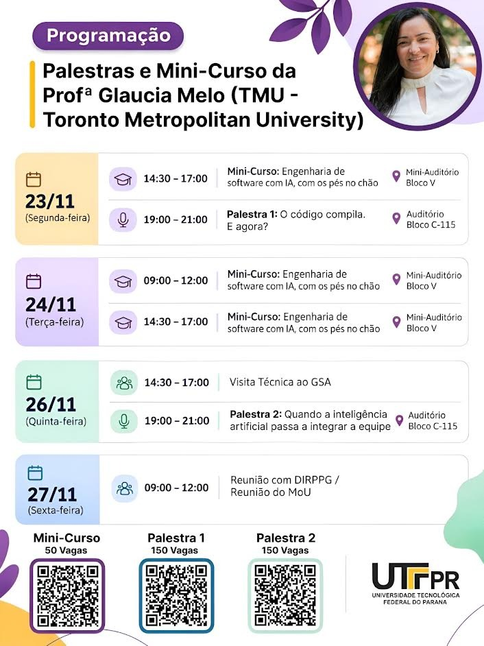

# 🤖 Mini-Curso e Palestras: Engenharia de Software com IA

Repositório de acompanhamento, estudos, anotações e práticas do mini-curso e ciclo de palestras ministrados pela **Profª Drª Glaucia Melo** ([Toronto Metropolitan University - TMU](https://www.torontomu.ca/)) na **Universidade Tecnológica Federal do Paraná (UTFPR)**.

<div align="center">
  
</div>

---

## 📅 Programação do Evento (23/11 a 27/11)

| Data | Horário | Tipo | Atividade / Tema | Local | Status |
| :--- | :--- | :--- | :--- | :--- | :---: |
| **23/11 (Seg)** | 14:30 - 17:00 | **Mini-Curso** | *Engenharia de software com IA, com os pés no chão* (Parte 1) | Mini-Auditório Bloco V | 🔄 Em andamento |
| **23/11 (Seg)** | 19:00 - 21:00 | **Palestra 1** | *O código compila. E agora?* | Auditório Bloco C-115 | ⏳ Pendente |
| **24/11 (Ter)** | 09:00 - 12:00 | **Mini-Curso** | *Engenharia de software com IA, com os pés no chão* (Parte 2) | Mini-Auditório Bloco V | ⏳ Pendente |
| **24/11 (Ter)** | 14:30 - 17:00 | **Mini-Curso** | *Engenharia de software com IA, com os pés no chão* (Parte 3) | Mini-Auditório Bloco V | ⏳ Pendente |
| **26/11 (Qui)** | 14:30 - 17:00 | **Visita** | *Visita Técnica ao GSA* | GSA | ⏳ Pendente |
| **26/11 (Qui)** | 19:00 - 21:00 | **Palestra 2** | *Quando a inteligência artificial passa a integrar a equipe* | Auditório Bloco C-115 | ⏳ Pendente |
| **27/11 (Sex)** | 09:00 - 12:00 | **Reunião** | *Reunião com DIRPPG / Reunião do MoU* | - | ⏳ Pendente |

---

## 🗂️ Estrutura do Repositório

```text
minicurso-Eng-Soft-IA/
├── assets/                  # Banners e mídias de apoio
│   └── programacao.jpg
├── notebooks/               # Práticas e cadernos do Google Colab / Jupyter
│   └── Colab1_Inspect_Before_You_Trust.ipynb
├── anotacoes/               # Anotações e sínteses das palestras
│   ├── palestra-1-o-codigo-compila-e-agora.md
│   └── palestra-2-quando-ia-passa-a-integrar-equipe.md
├── .gitignore
└── README.md
```

---

## 🧪 Práticas & Cadernos (Notebooks)

- [`notebooks/Colab1_Inspect_Before_You_Trust.ipynb`](notebooks/Colab1_Inspect_Before_You_Trust.ipynb)
  - **Módulo 1:** *Quality and Correctness of AI-Generated Code* (Profª Glaucia Melo - TMU).
  - **Foco:** Análise crítica de código gerado por IA (12 soluções em 4 tarefas), execução de baterias de testes, ferramentas de métricas/qualidade estática e fundamentação de decisões baseadas em múltiplas evidências.

---

## 📝 Anotações das Palestras

- [Palestra 1: O código compila. E agora?](anotacoes/palestra-1-o-codigo-compila-e-agora.md) *(23/11 - 19h)*
- [Palestra 2: Quando a inteligência artificial passa a integrar a equipe](anotacoes/palestra-2-quando-ia-passa-a-integrar-equipe.md) *(26/11 - 19h)*

---

## 👤 Autor

- **André M. da Silva** ([@ZandreK](https://github.com/ZandreK))
- UTFPR - Universidade Tecnológica Federal do Paraná
